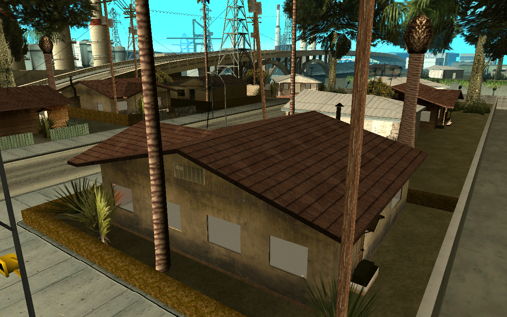
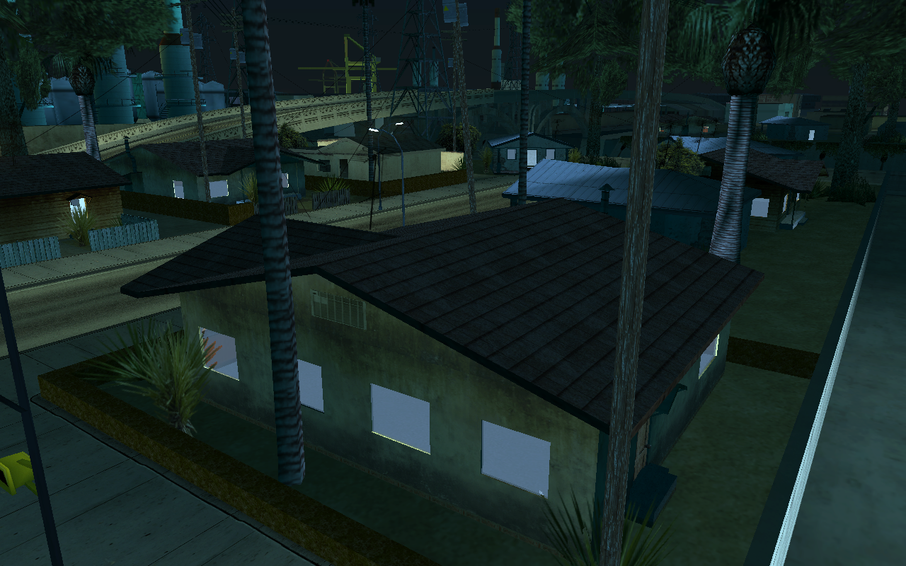
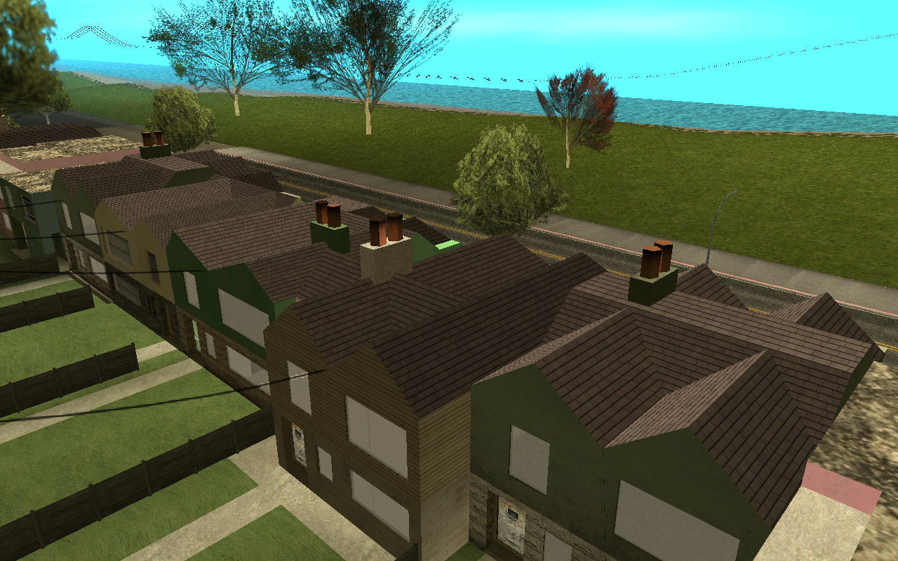
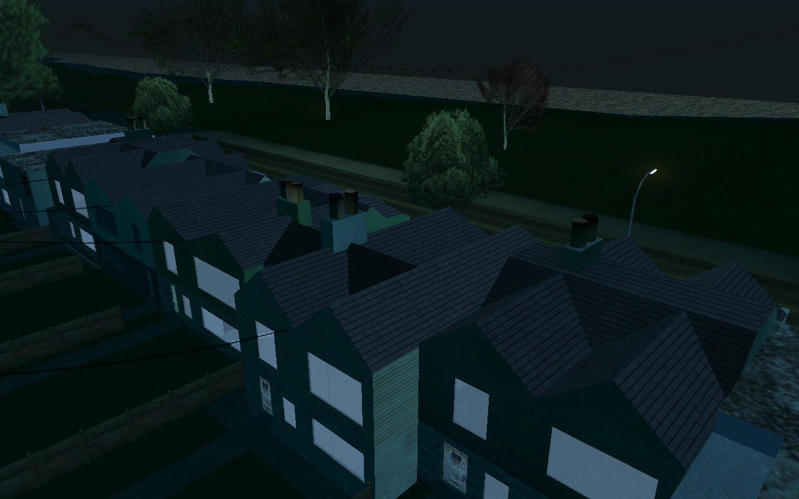
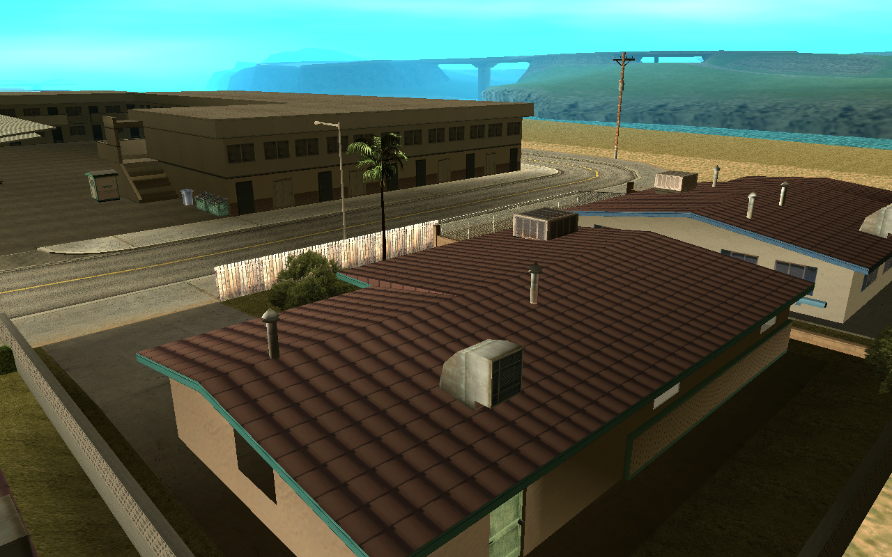
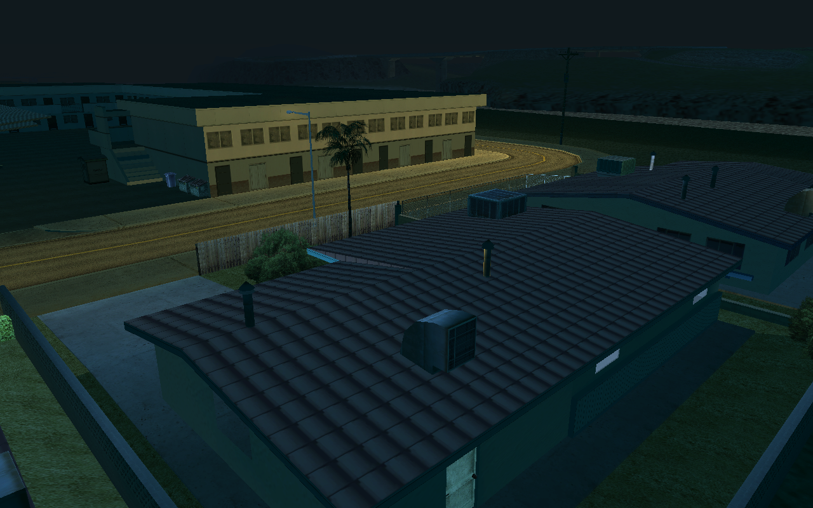

# samp-house-shells

Making SA-MP's enterable house shells look like they belong in San Andreas.


The SA-MP client ships a set of house models in `SAMP\SAMP.img`: an exterior that reuses a vanilla house's
textures plus a separate interior, for LS, SF and LV.

| ids | exteriors | interiors |
|---|---|---|
| 19489–19496 | `sfhouse1`–`sfhouse4` | `sfhouse1int`–`sfhouse4int` |
| 19497–19504 | `lvhouse1`–`lvhouse4` | `lvhouse1int`–`lvhouse4int` |
| 19505–19512 | `lshouse1`–`lshouse4` | `lshouse1int`–`lshouse4int` |

Servers use them in place of the solid vanilla houses so that players can walk in. Next to the vanilla city they look
out of place. This repo holds the tooling, the reworked models and before/after screenshots. The goal is replacement
DFF files that any SA-MP or MTA:SA server can use as a drop-in.

## Status

| | problem | state |
|---|---|---|
| [#2](https://github.com/VIRUXE/samp-house-shells/issues/2) | interiors have no baked lighting, stay day-bright at night | **baked** for all 12 interiors (`models/baked/`); in-game check pending |
| [#3](https://github.com/VIRUXE/samp-house-shells/issues/3) | windows are flat panes, glow white at night | open |
| [#4](https://github.com/VIRUXE/samp-house-shells/issues/4) | no ceiling from inside | open; the LS interiors have none, several SF/LV ones do (`mp_burn_ceiling`) |
| [#5](https://github.com/VIRUXE/samp-house-shells/issues/5) | every interior uses the generic `all_walls` textures | open |
| [#6](https://github.com/VIRUXE/samp-house-shells/issues/6) | no LOD models | open |
| [#7](https://github.com/VIRUXE/samp-house-shells/issues/7) | drop-in package for SA-MP and MTA:SA | open |

## Before and after

### Baked interior lighting (#2)

The original `*int` models have no prelight at all (geometry flags `0x10036`, no prelit bit `0x08`, no night
colours), so the game lights them uniformly and they glow at midnight. They now carry day and night vertex
colours baked from Cycles ambient occlusion, with the exterior loaded as an occluder. Each model's material colour
goes from grey 127 to white, because SA multiplies texture × prelight × material colour.


<details>
<summary>Exteriors as they are today (not reworked yet)</summary>

| | noon | midnight |
|---|---|---|
| LS `lshouse1` |  |  |
| SF `sfhouse2` |  |  |
| LV `lvhouse1` |  |  |

</details>

All shots are viewport captures from [Ariane](https://github.com/Dryxio/ariane) at weather 1, taken by
`ariane/shots.ps1` from fixed cameras, so before and after line up exactly. The placements are a real server's: the
house maps of [Scavenge & Survive](https://github.com/Southclaws/ScavengeSurvive) (CC BY-SA 4.0), which also remove
the vanilla houses underneath.

## Layout

| path | what |
|---|---|
| `models/original/` | the 24 shell DFFs and `all_walls.txd`, extracted from SA-MP's `SAMP.img` |
| `models/baked/` | reworked interiors (drop-in replacements, same names) |
| `screenshots/before`, `after`, `compare` | Ariane captures and the generated before/after grids |
| `tools/img.py` | IMG v2 extract/build |
| `tools/bake_interiors.py` | headless Blender bake of the interiors |
| `tools/view_house.py` | opens a house in Blender: original interior left, baked right, game-style shading, `night` slider |
| `tools/compare.py` | builds `screenshots/compare/*.png` |
| `tools/make_ipl.py` | server placements → IPL for Ariane |
| `tools/blender_call.py` | sends one command to a running Blender's blender-mcp socket (screenshots, scripted edits) |
| `ariane/*.ps1` | start/drive Ariane, swap original/baked shells, take the named shots |

## Workflow

```powershell
# bake (headless, ~1 min for all 12)
& 'C:\Program Files\Blender Foundation\Blender 5.2\blender.exe' --background --factory-startup --python tools/bake_interiors.py -- models/original models/baked
# look at one in Blender (original left, baked right; Scene properties > Custom Properties > night)
& 'C:\Program Files\Blender Foundation\Blender 5.2\blender.exe' --python tools/view_house.py -- lshouse1
# see it in the world, then capture and compare
pwsh ariane/use-shells.ps1 baked        # or: original
pwsh ariane/shots.ps1 after             # or: before; optional name filter, e.g. '*-interior'
python -I tools/compare.py
```

DragonFF notes. SA-MP's shells keep their material ids only in the BinMesh PLG; the triangle list says material 0
everywhere. Import with `read_mat_split=True`, or every face gets the first texture. Import with
`remove_doubles=False`, or overlapping faces are merged away. The bake checks that each output's BinMesh matches
the original's.

## Tools

- [Ariane](https://github.com/Dryxio/ariane) Agent Alpha 1 (map editor with a CLI/MCP agent interface), on a
  dedicated copy of the game so it never writes to the install you play on.
- [GTA Scout](https://github.com/Dryxio/gta-scout) to find vanilla textures and props that fit.
- Blender 5.2 with [DragonFF](https://github.com/Parik27/DragonFF) (latest `master`; DFF/TXD import and export,
  day/night vertex colours) and [blender-mcp](https://github.com/ahujasid/blender-mcp).

## Setup

1. Copy the game (with its `SAMP` folder) somewhere else, e.g. `D:\Games\GTA San Andreas\ariane-sa`, and put
   `ariane.exe` and `fonts\` from the Agent Alpha bundle next to `gta_sa.exe`.
2. In the copy's `data\gta.dat`, add the following lines. Put the `IMG` lines after the existing `IMG` lines, the
   `IDE` lines after the last `IDE` line, and the `IPL` line at the end. Later IMG lines override entries of the
   same name, which is how `SHELLS.IMG` swaps in the reworked models; `ariane/use-shells.ps1` manages that line.

   ```
   IMG SAMP\SAMP.IMG
   IMG SAMP\SAMPCOL.IMG
   IMG SAMP\CUSTOM.IMG
   IMG SHELLS\SHELLS.IMG
   IDE SAMP\SAMP.IDE
   IDE SAMP\CUSTOM.IDE
   IPL SCAVENGE\SCAVENGE.IPL
   ```

3. Generate the placements and run the editor:

   ```powershell
   python -I tools/make_ipl.py <scavengesurvive-mta checkout> <game copy> <game copy>\scavenge
   pwsh ariane/start.ps1              # editor on port 48731, token in %LOCALAPPDATA%\ariane-agent\token
   pwsh ariane/apply-removals.ps1     # replays the maps' RemoveBuildingForPlayer list as a scratch session
   ```

   `make_ipl.py` reads the map data that [scavengesurvive-mta](https://github.com/VIRUXE/scavengesurvive-mta)
   generates from the upstream `.map` files. It writes a text IPL plus the removal list. Map-wide removals are
   expanded into one entry per vanilla instance, because Ariane caps `suppress-world-models` at a 250 m radius.

4. For `tools/view_house.py`, extract the vanilla TXDs it shows into the ignored `work/txd/` folder:
   `python -I tools/img.py extract <game copy>\models\gta3.img work/txd ganghouse1_lax.txd comedhos1_la.txd glenphouse_lax.txd boxhses_sfsx.txd vegashse2.txd vegashse3.txd vegashse4.txd vegashse6.txd`, plus
   `copy models\original\all_walls.txd work\txd\`.

## Licence

The scripts, screenshots and our edits are released into the public domain under [the Unlicense](LICENSE). The
model files come from the SA-MP client. Vanilla GTA San Andreas files are never committed (`work/` is ignored).
