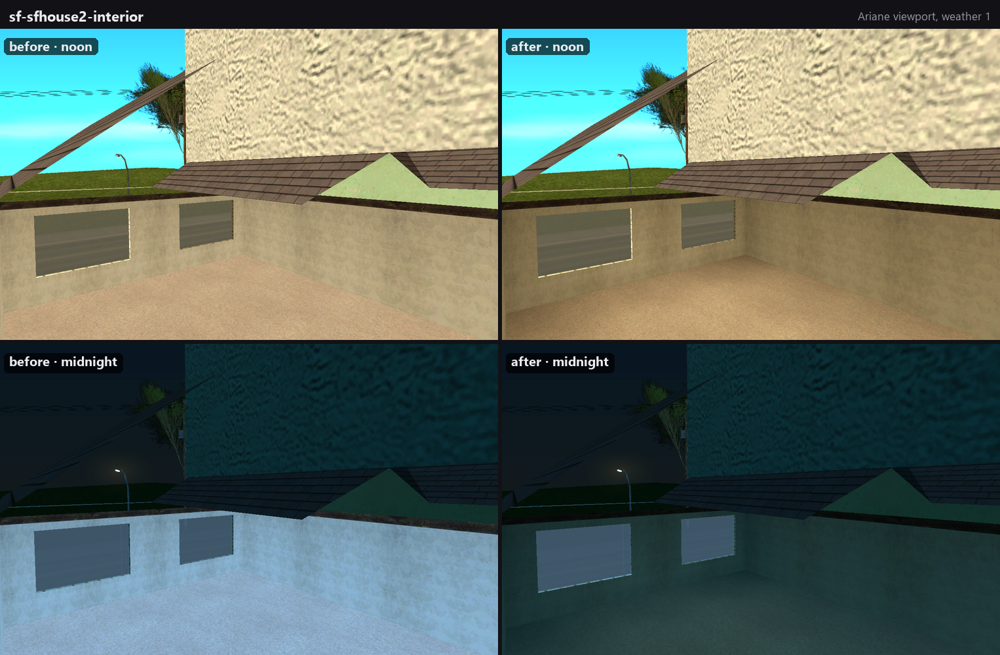
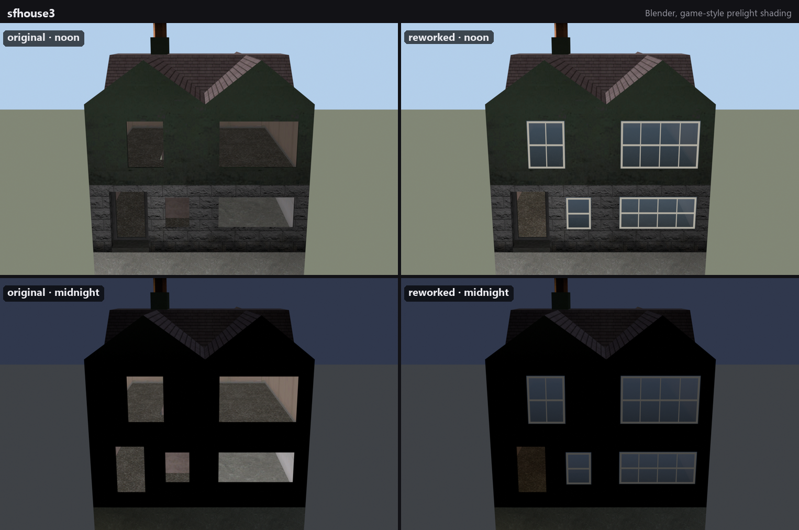
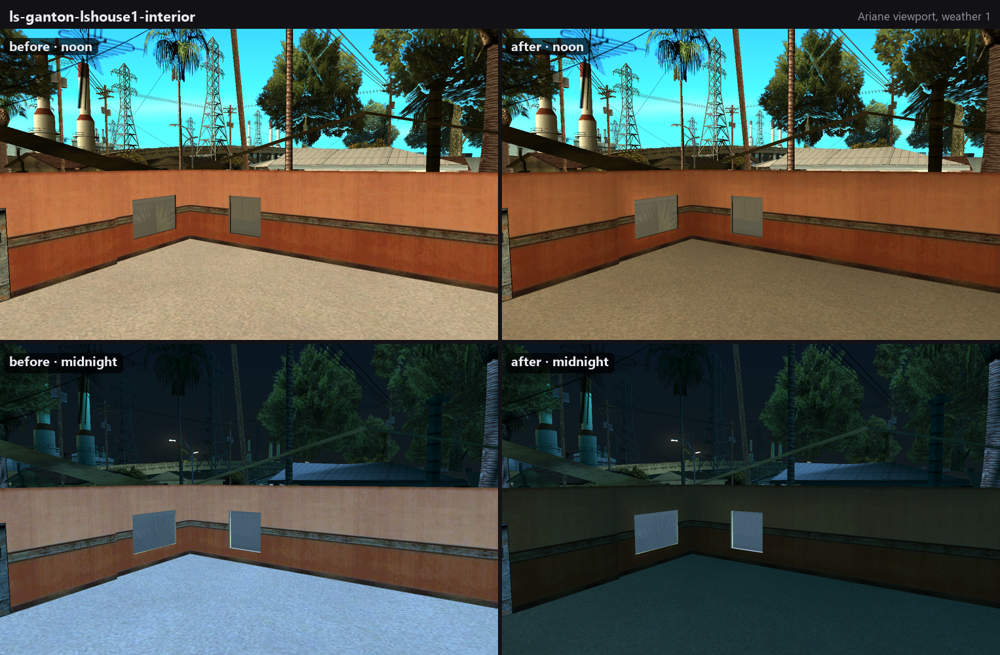
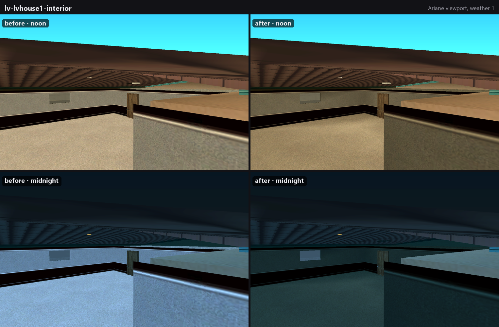
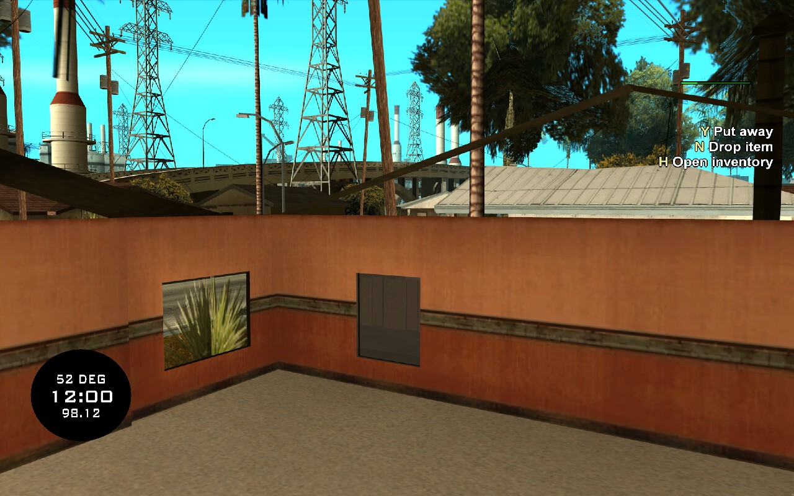
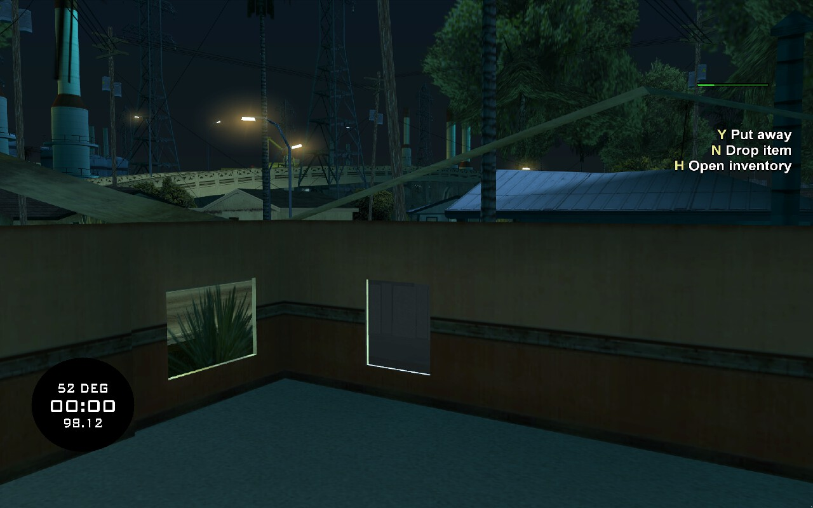
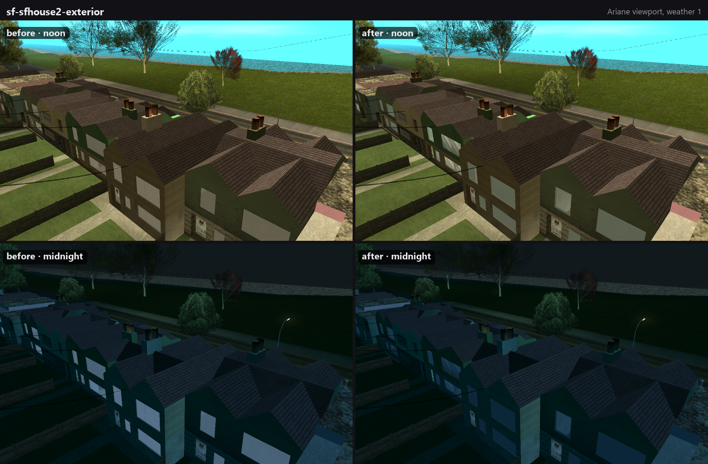
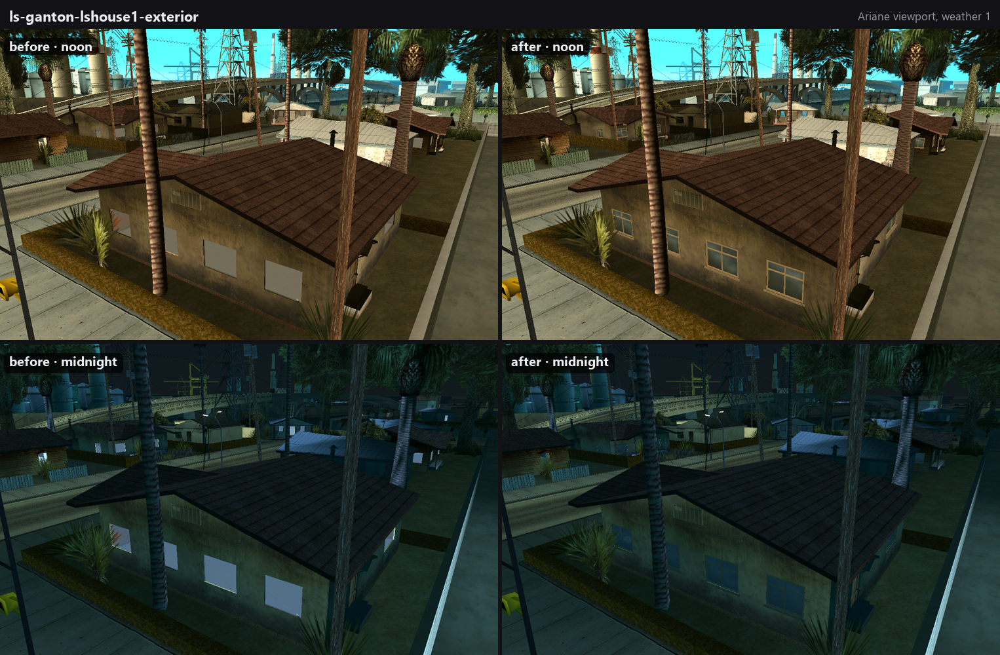
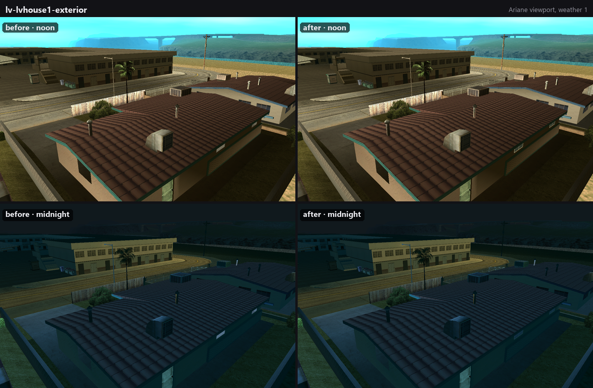

# samp-house-shells

Making SA-MP's enterable house shells look like they belong in San Andreas.



The SA-MP client ships a set of house models in `SAMP\SAMP.img`: an exterior that reuses a vanilla house's
textures plus a separate interior, for LS, SF and LV.

| ids | exteriors | interiors |
|---|---|---|
| 19489–19496 | `sfhouse1`–`sfhouse4` | `sfhouse1int`–`sfhouse4int` |
| 19497–19504 | `lvhouse1`–`lvhouse4` | `lvhouse1int`–`lvhouse4int` |
| 19505–19512 | `lshouse1`–`lshouse4` | `lshouse1int`–`lshouse4int` |

Servers use them in place of the solid vanilla houses so that players can walk in. Next to the vanilla city they look
out of place. This repo holds the tooling, the reworked models and before/after screenshots. The goal is replacement
DFF files that any SA-MP or MTA:SA server can use as a drop-in.

## Status

| | problem | state |
|---|---|---|
| [#2](https://github.com/VIRUXE/samp-house-shells/issues/2) | interiors have no baked lighting, stay day-bright at night | **done**: all 12 interiors baked (`models/baked/`), checked in MTA:SA |
| [#3](https://github.com/VIRUXE/samp-house-shells/issues/3) | windows are flat panes, glow white at night | **in progress**: every shell glazed with framed, vanilla-dark glass, so maps can drop `window001`, which no longer glows either; to do: MTA:SA check |
| [#4](https://github.com/VIRUXE/samp-house-shells/issues/4) | no ceiling from inside | open; in-game the roof underside does show from inside, but sky shows through the gap between the interior walls and the roof (LS); several SF/LV interiors have their own ceiling |
| [#5](https://github.com/VIRUXE/samp-house-shells/issues/5) | every interior uses the generic `all_walls` textures | open |
| [#6](https://github.com/VIRUXE/samp-house-shells/issues/6) | no LOD models | open |
| [#7](https://github.com/VIRUXE/samp-house-shells/issues/7) | drop-in package for SA-MP and MTA:SA | open |

## Before and after

**[All 12 houses, original next to reworked, rendered in Blender →](docs/houses.md)**

[](docs/houses.md)

### Baked interior lighting (#2)

The original `*int` models have no prelight at all (geometry flags `0x10036`, no prelit bit `0x08`, no night
colours), so the game lights them uniformly and they glow at midnight. They now carry day and night vertex
colours baked from Cycles ambient occlusion, with the exterior loaded as an occluder. Each model's material colour
goes from grey 127 to white, because SA multiplies texture × prelight × material colour.




In game (MTA:SA client, same house, the baked model loaded via `engineReplaceModel`):

| noon | midnight |
|---|---|
|  |  |

### Glazed windows (#3)

The shells ship with open window holes. Maps fill each one with SA-MP's 19466 `window001`: 1,643 objects in the
Scavenge & Survive houses alone. That model has no prelight and a grey 127 material, so every pane glowed white
at night, and its texture was a flat 16×16 grey at 85% alpha.

- **Each exterior now has its own glass.** Every opening gets a double-sided pane and a frame styled after the window
  texture in the house's vanilla TXD: white sashes in SF, weathered wood in Ganton, louvres, security bars, and so
  on (see [the houses](docs/houses.md)). Everything else in the DFF is left exactly as SA-MP shipped
  it. With these models a server can stop placing `window001` in the houses.
- **The look follows vanilla's see-through glass.** In the Wang Cars showroom (`carshowwin_SFSX`) and the SF
  Ammu-Nation (`ammuwindows_SFS`), glass is a white-material alpha texture with dark prelight (about 35 by day). It
  reads as glass with the room behind it, never as a grey board; light, lit-from-inside windows come only from
  bright night colours. The exteriors use vanilla TXDs, which have no glass texture, so the panes are untextured:
  alpha 170, prelight graded from about 30 at the bottom to 60 at the top like a sky reflection, and dark at night.
- **`window001` is fixed as well**, for maps that keep it. It gets day/night prelight and a white material, and
  `lsmall_window01` in `lsmall_shops.txd` becomes a 64×64 glass texture: a sky-to-street gradient with two
  reflection streaks, at 59% alpha so the room shows through. 19325 `lsmall_window01` (shop glass) shares that
  texture.

How the openings are found:
1. `tools/window_seeds.py` takes every `window001` near a shell into that shell's frame, plus every door object.
   Offsets that recur in at least half of the instances become seeds (`data/window_seeds.json`).
2. `tools/glaze_shells.py` adds seeds of its own. Maps glaze only some holes: lshouse3 gets one, and lvhouse4's
   seeds sit outside the model. The script sweeps each exterior with horizontal rays from 8 directions, groups the
   hits into wall planes, and takes every enclosed gap in a plane as a seed.
3. Each seed is fitted: rays are cast through the wall on a 4 cm grid around it, and the open region connected to the
   seed is the opening. Openings that leak past ±3 m are dropped. Scanned openings are also dropped when they:
   - hold a map door object (an entrance),
   - are not fully rectangular (an arched doorway), or
   - are over 2.4 m tall (a garage).
4. The fitted openings go to `data/windows.json` (each tagged `map` or `scan`), and `tools/add_panes.py` writes the
   panes.

`ariane/tour.py` flies the editor round one instance of each shell and captures it from two corners, which is how
the missing panes were spotted.





The "after" shots hide every `window001` (`apply-removals.ps1 -WithoutPanes`), so the glass you see is the
shells' own.

All shots are viewport captures from [Ariane](https://github.com/Dryxio/ariane) at weather 1, taken by
`ariane/shots.ps1` from fixed cameras, so before and after line up exactly. The placements are a real server's: the
house maps of [Scavenge & Survive](https://github.com/Southclaws/ScavengeSurvive) (CC BY-SA 4.0), which also remove
the vanilla houses underneath.

## Layout

| path | what |
|---|---|
| `models/original/` | the 24 shell DFFs and `all_walls.txd`, extracted from SA-MP's `SAMP.img` |
| `models/original/window001.dff`, `lsmall_shops.txd` | SA-MP's window pane and its TXD, extracted from `SAMP.img` |
| `models/baked/` | reworked models (drop-in replacements, same names): baked interiors, glazed exteriors, `window001`, `lsmall_shops.txd` |
| `data/window_seeds.json`, `data/windows.json` | where maps put window panes per shell, and the openings fitted from them |
| `screenshots/before`, `after`, `compare` | Ariane captures and the generated before/after grids |
| `screenshots/ingame` | MTA:SA client captures |
| `tools/img.py` | IMG v2 extract/build |
| `tools/bake_interiors.py` | headless Blender bake of the interiors |
| `tools/window_seeds.py` | `window001` placements → per-shell seeds |
| `tools/glaze_shells.py` | headless Blender: fits each seed to its opening by ray casting |
| `tools/add_panes.py` | writes the framed panes into the exteriors (gtaLib, rest of the DFF untouched) |
| `tools/rework_window.py` | prelight for `window001`, new glass texture in `lsmall_shops.txd` |
| `tools/view_house.py` | opens a house in Blender: original interior left, baked right, game-style shading, `night` slider |
| `tools/compare.py` | builds `screenshots/compare/*.png` |
| `tools/render_houses.py`, `tools/gallery.py` | Blender renders of every house, original and reworked, and the `docs/houses.md` grids |
| `tools/make_ipl.py` | server placements → IPL for Ariane |
| `tools/blender_call.py` | sends one command to a running Blender's blender-mcp socket (screenshots, scripted edits) |
| `ariane/*.ps1`, `ariane/removals.py`, `ariane/look_at.py`, `ariane/tour.py` | start/drive Ariane, swap original/baked models, replay removals over one connection, aim the camera at a placed model (vanilla references), tour every shell, take the named shots |

## Workflow

```powershell
# bake (headless, ~1 min for all 12)
& 'C:\Program Files\Blender Foundation\Blender 5.2\blender.exe' --background --factory-startup --python tools/bake_interiors.py -- models/original models/baked
# glaze the exteriors and rework window001 (DragonFF checkout for gtaLib)
python -I tools/window_seeds.py <game copy>\scavenge\scavenge.ipl data/window_seeds.json
& 'C:\Program Files\Blender Foundation\Blender 5.2\blender.exe' --background --factory-startup --python tools/glaze_shells.py -- models/original data/window_seeds.json data/windows.json
python -I tools/add_panes.py <DragonFF> models/original data/windows.json models/baked
python -I tools/rework_window.py <DragonFF> models/original models/baked
# look at one in Blender (original left, baked right; Scene properties > Custom Properties > night)
& 'C:\Program Files\Blender Foundation\Blender 5.2\blender.exe' --python tools/view_house.py -- lshouse1
# see it in the world, then capture and compare
pwsh ariane/use-shells.ps1 baked        # or: original; baked also hides the maps' window001
pwsh ariane/shots.ps1 after             # or: before; optional name filter, e.g. '*-interior'
python -I tools/compare.py
```

DragonFF notes. gtaLib reads the BinMesh into a plain list (`extensions["mat_split"]`) that its writer cannot
serialise. The gtaLib tools move those triangles, which carry the real material ids, into `geometry.triangles`
and let the writer rebuild the BinMesh. SA-MP's shells keep their material ids only in the BinMesh PLG; the triangle list says material 0
everywhere. Import with `read_mat_split=True`, or every face gets the first texture. Import with
`remove_doubles=False`, or overlapping faces are merged away. The bake checks that each output's BinMesh matches
the original's.

## Tools

- [Ariane](https://github.com/Dryxio/ariane) Agent Alpha 1 (map editor with a CLI/MCP agent interface), on a
  dedicated copy of the game so it never writes to the install you play on.
- [GTA Scout](https://github.com/Dryxio/gta-scout) to find vanilla textures and props that fit.
- Blender 5.2 with [DragonFF](https://github.com/Parik27/DragonFF) (latest `master`; DFF/TXD import and export,
  day/night vertex colours) and [blender-mcp](https://github.com/ahujasid/blender-mcp).

## Setup

1. Copy the game (with its `SAMP` folder) somewhere else, e.g. `D:\Games\GTA San Andreas\ariane-sa`, and put
   `ariane.exe` and `fonts\` from the Agent Alpha bundle next to `gta_sa.exe`.
2. In the copy's `data\gta.dat`, add the following lines. Put the `IMG` lines after the existing `IMG` lines, the
   `IDE` lines after the last `IDE` line, and the `IPL` line at the end. Later IMG lines override entries of the
   same name, which is how `SHELLS.IMG` swaps in the reworked models; `ariane/use-shells.ps1` manages that line.

   ```
   IMG SAMP\SAMP.IMG
   IMG SAMP\SAMPCOL.IMG
   IMG SAMP\CUSTOM.IMG
   IMG SHELLS\SHELLS.IMG
   IDE SAMP\SAMP.IDE
   IDE SAMP\CUSTOM.IDE
   IPL SCAVENGE\SCAVENGE.IPL
   ```

3. Generate the placements and run the editor:

   ```powershell
   python -I tools/make_ipl.py <scavengesurvive-mta checkout> <game copy> <game copy>\scavenge
   pwsh ariane/start.ps1              # editor on port 48731, token in %LOCALAPPDATA%\ariane-agent\token
   pwsh ariane/apply-removals.ps1     # replays the maps' RemoveBuildingForPlayer list as a scratch session
                                      # (-WithoutPanes also hides window001; takes seconds)
   ```

   `make_ipl.py` reads the map data that [scavengesurvive-mta](https://github.com/VIRUXE/scavengesurvive-mta)
   generates from the upstream `.map` files. It writes a text IPL plus the removal list. Map-wide removals are
   expanded into one entry per vanilla instance, because Ariane caps `suppress-world-models` at a 250 m radius.

4. For `tools/view_house.py`, extract the vanilla TXDs it shows into the ignored `work/txd/` folder:
   `python -I tools/img.py extract <game copy>\models\gta3.img work/txd ganghouse1_lax.txd comedhos1_la.txd glenphouse_lax.txd boxhses_sfsx.txd vegashse2.txd vegashse3.txd vegashse4.txd vegashse6.txd`, plus
   `copy models\original\all_walls.txd work\txd\`.

## Licence

The scripts, screenshots and our edits are released into the public domain under [the Unlicense](LICENSE). The
model files come from the SA-MP client. Vanilla GTA San Andreas files are never committed (`work/` is ignored).
