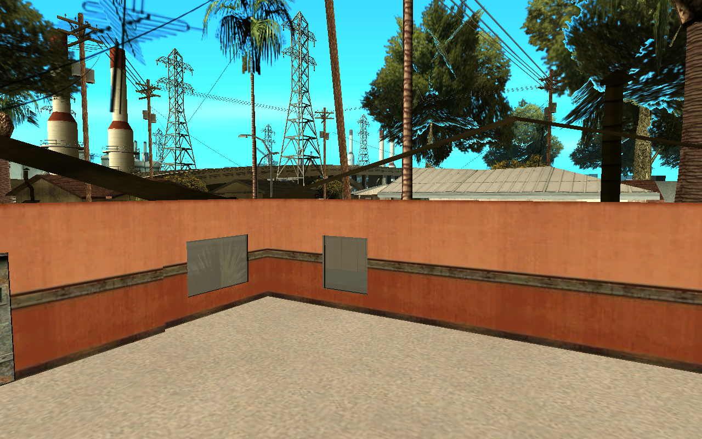
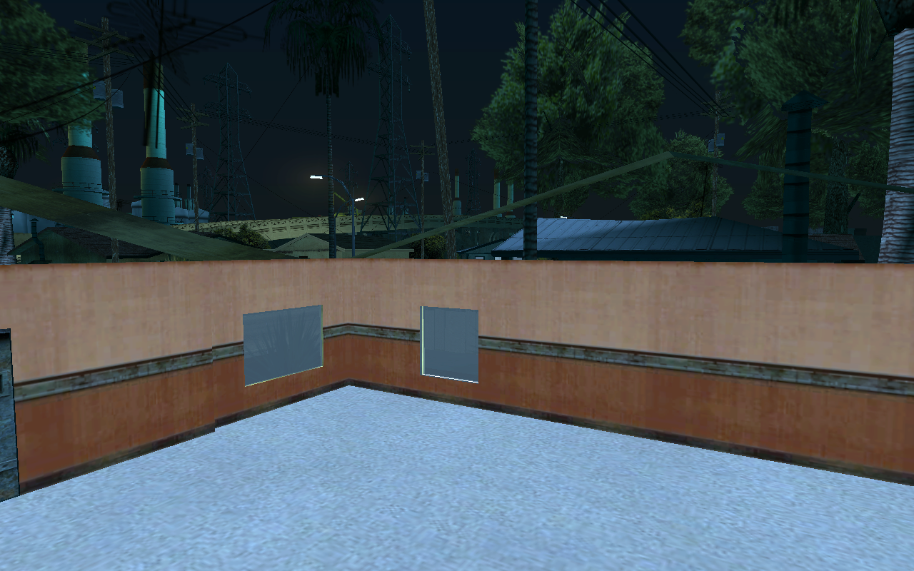

# scavengesurvive-shells

Making the enterable SA-MP house shells (`lshouse*`, `sfhouse*`, `lvhouse*` and their `*int` interiors, models
19490–19512) that Scavenge & Survive places over vanilla houses fit the San Andreas world. The game-side code
lives in [scavengesurvive-mta](../samp/scavengesurvive-mta); this repo holds the tooling, the reworked assets
and the before/after evidence.

## What is wrong (before)

| | noon | midnight |
|---|---|---|
| LS `lshouse1` exterior |  |  |
| LS `lshouse1int` interior |  |  |
| SF `sfhouse2` exterior |  |  |
| LV `lvhouse1` exterior |  |  |

- **Interiors are not prelit.** `*int` DFFs (and the `wall0xx` pieces) have no vertex colours or night colours
  (geometry flags `0x10036`, no `0x08`), so they stay day-bright at midnight while everything around them darkens.
- **Windows are flat panes** that read as grey boards by day and glow white at night.
- **No ceiling from inside:** the interior has none and the exterior roof is single-sided (seen in Ariane; to be
  confirmed in MTA).
- **One generic `all_walls` texture set** for every interior; **no LODs**, so shells pop in at 200 m.

Shots are Ariane viewport captures of the same placements MTA uses (`tools/make_ipl.py`), weather 1.

## Setup

Installed under `C:\dev\gta\sa\tools`: Ariane Agent Alpha 1 (`ariane-agent/`), gta-scout (`gta-scout/`, with
DragonFF pinned in `references/`), blender-mcp. Blender 5.2 has the DragonFF and blender-mcp add-ons.
Claude Code has the `ariane` and `blender` MCP servers (user scope).

Ariane runs on its own game copy, `D:\Games\GTA San Andreas\ariane-sa`, never on the install MTA uses. Its
`data\gta.dat` adds `SAMP\SAMP.IMG`, `SAMPCOL.IMG`, `CUSTOM.IMG`, `SAMP.IDE`, `CUSTOM.IDE` and
`SCAVENGE\SCAVENGE.IPL` (original kept as `gta.dat.orig`).

```powershell
python -I tools/make_ipl.py C:\dev\gta\sa\samp\scavengesurvive-mta 'D:\Games\GTA San Andreas\ariane-sa' 'D:\Games\GTA San Andreas\ariane-sa\scavenge'
pwsh ariane/start.ps1             # editor on port 48731, token in %LOCALAPPDATA%\ariane-agent\token
pwsh ariane/apply-removals.ps1    # upstream RemoveBuildingForPlayer list as a scratch session
pwsh ariane/ctl.ps1 camera 2712 -1972 22 2695.1 -1983.8 16 60
pwsh ariane/ctl.ps1 capture C:\path\shot.png
```
