# The houses

Every SA-MP house shell, rendered in Blender by `tools/render_houses.py`: SA-MP's original on the left, this repo's
on the right, noon on top and midnight below. Each render loads the exterior together with its interior, so the glass
has a room behind it.

Materials are shaded the way the game lights buildings: texture × material colour × 2 × prelight, with the prelight
blended from the day colours to the night colours. The products are taken in gamma space, as SA does. Midnight
renders are exposed 1.3 stops up so they stay readable; in game, the ambient light added to buildings does much the
same. The camera looks from the corner between the two walls with the most glass.

Each window is built from untextured parts, with the detail in vertex colours (the day and night prelight SA lerps
per vertex), because the vanilla TXDs the exteriors use have no glass, frame or fabric textures:

- the opening is lined to the depth of the wall (measured against the interior model), with a sill that stands out;
- the glass sits half way into the wall and carries a sky-to-street gradient, a soft diagonal reflection band and
  darker edges, at vanilla's dark see-through level;
- the frame bars are boxes that stand out of the glass, with lit tops and dark undersides;
- behind the glass hang curtains (with folds), a part-lowered blind (with slats) or nothing, chosen per window with a
  fixed seed, in the district's colours.

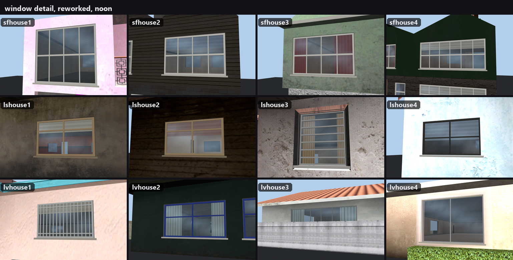

Frames follow the window texture in each house's vanilla TXD (`STYLES` in `tools/add_panes.py`), so a pane looks like
the windows on the vanilla houses next to it.

| house | vanilla TXD | window reference | frame |
|---|---|---|---|
| `sfhouse1`–`sfhouse4` | `boxhses_sfsx` | `ws_boxhouse_wins5`, `ws_boxhouse_wins7` | white sash: thick meeting rail at half height, glazing bars about every 0.75 m |
| `lshouse1`, `lshouse2` | `ganghouse1_lax` | `gangwin1_LAe` | weathered wood: centre mullion on wide openings, transom |
| `lshouse3` | `comedhos1_la` | `comptwindo1` | aluminium louvres: six horizontal slats |
| `lshouse4` | `glenphouse_lax` | `ws_boxhouse_wins3` | dark grey, four panes |
| `lvhouse1` | `vegashse2` | `comptwindo4` | off-white frame with security bars every 12 cm |
| `lvhouse2` | `vegashse3` | `newindow10` | blue-painted frame, four panes |
| `lvhouse3` | `vegashse6` | `sw_wind10` | grey mullions about every 0.8 m |
| `lvhouse4` | `vegashse4` | `comptwindo4`, `sw_wind07` | thin silver sliders, split in two |

## San Fierro

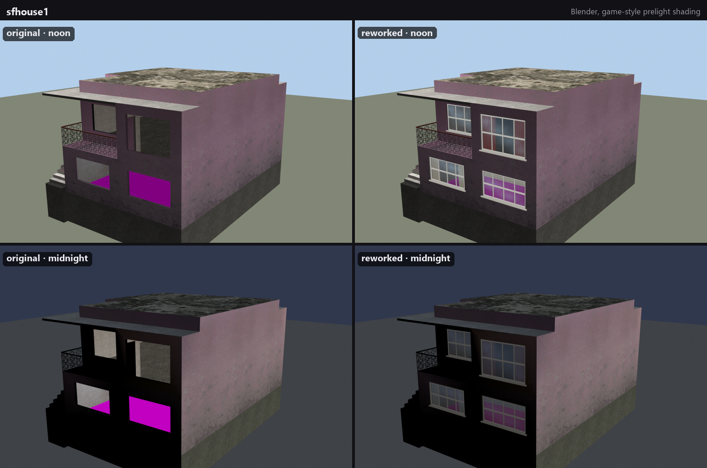
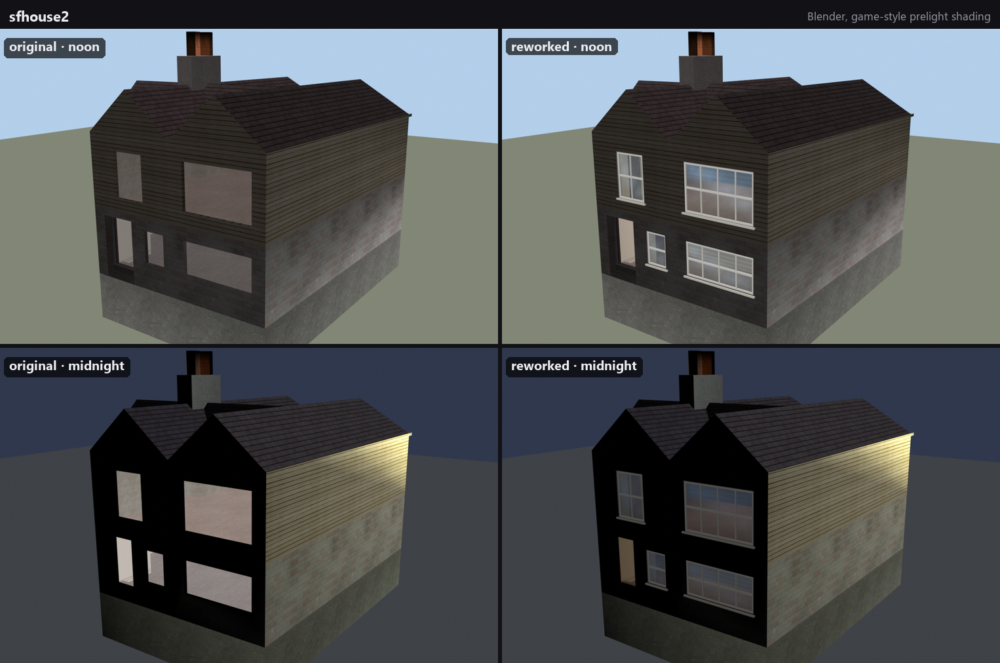

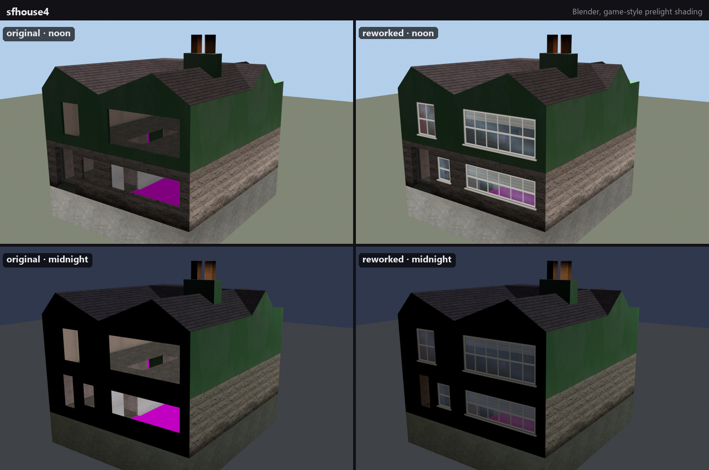

## Los Santos

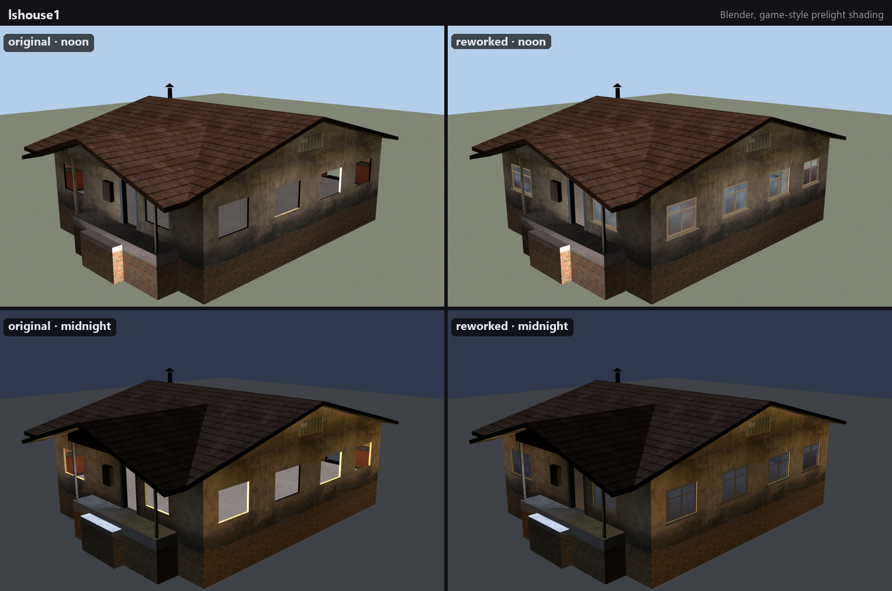
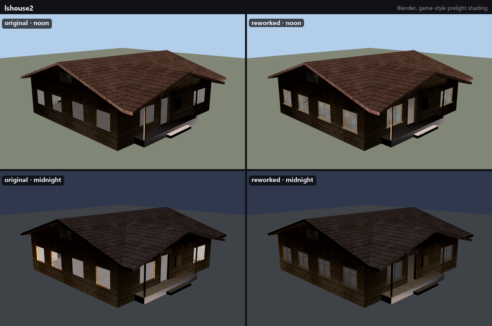
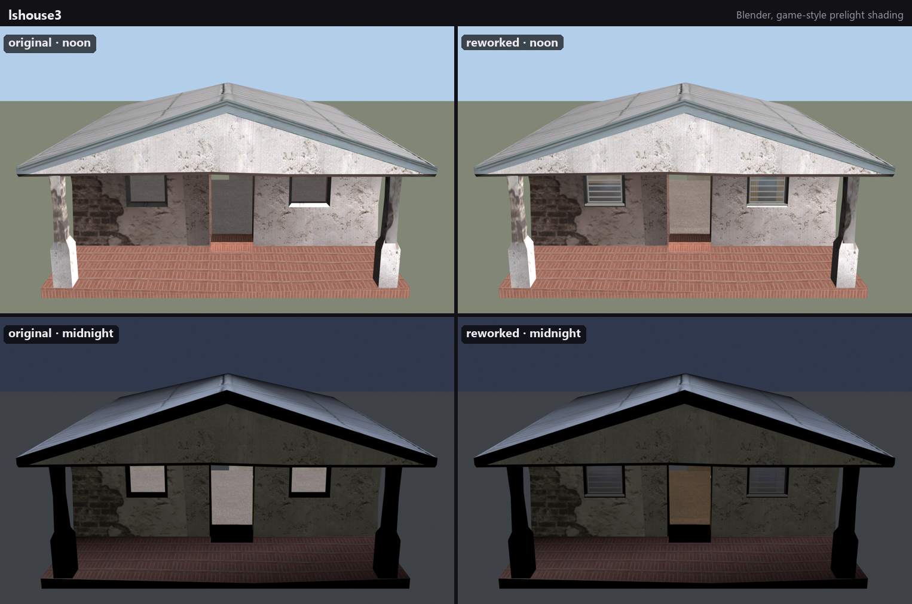
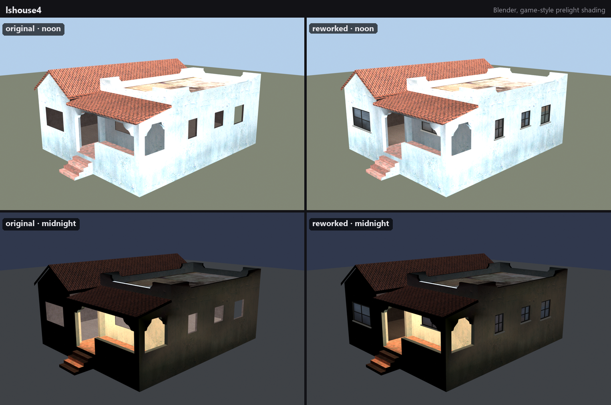

## Las Venturas

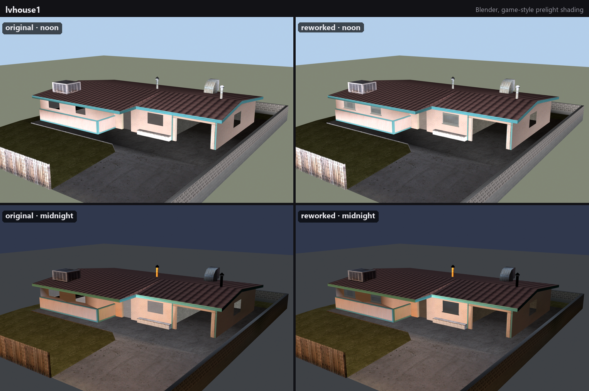
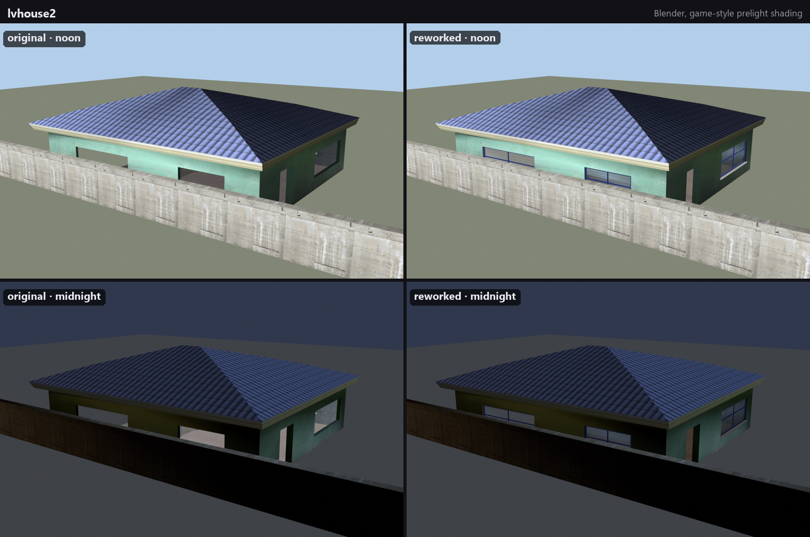
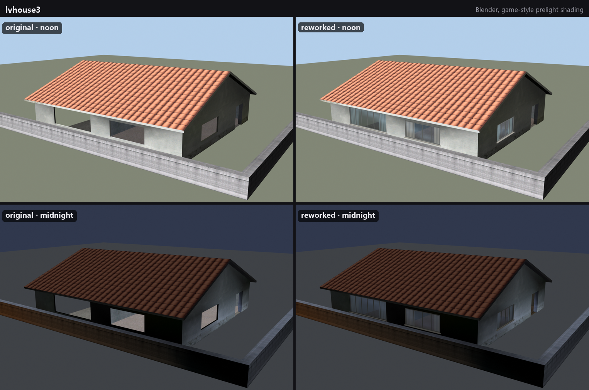
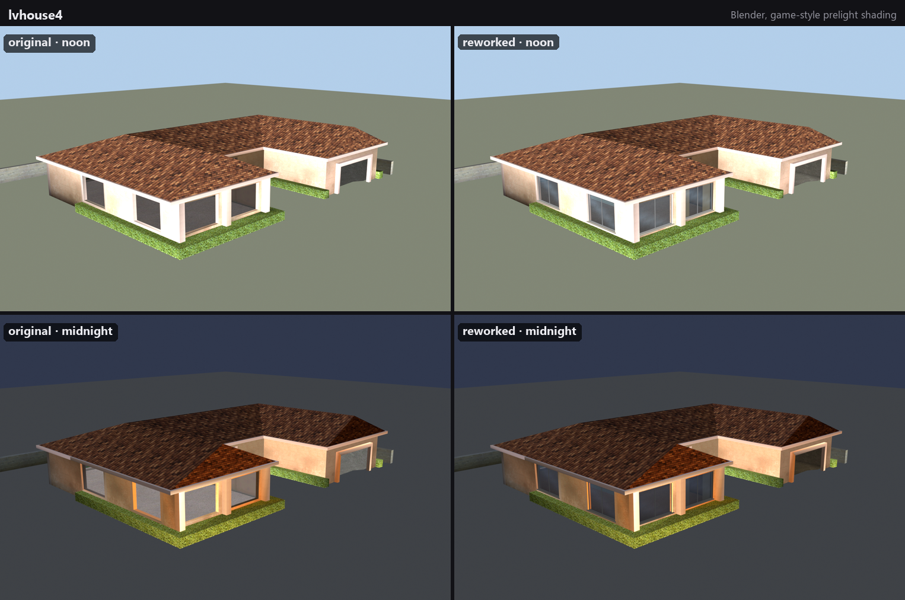

## Regenerating

```powershell
# needs the vanilla TXDs in work/txd (see the README's Setup); renders go to work/renders
& 'C:\Program Files\Blender Foundation\Blender 5.2\blender.exe' --background --factory-startup --python tools/render_houses.py
python -I tools/gallery.py
```
